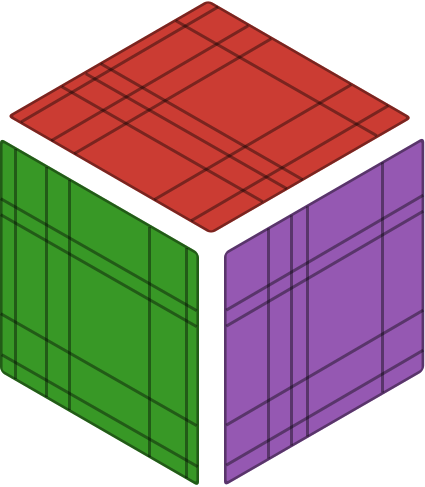
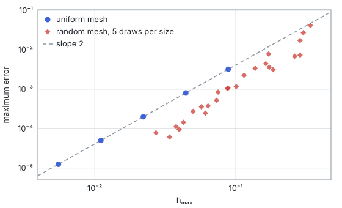

<p align="left">
  
</p>

# Bramble.jl

*Supraconvergent finite difference discretizations on nonuniform Cartesian grids.*

---

| **Documentation & DOI**  | [](https://gpena.github.io/Bramble.jl/) [](https://doi.org/10.5281/zenodo.14230821)                                                                                                                                                                                                                                                                                                 |
| :-------------------------| :-----------------------------------------------------------------------------------------------------------------------------------------------------------------------------------------------------------------------------------------------------------------------------------------------------------------------------------------------------------------------------------------------------------------------------------------------------------------------------------------------------------------------|
| **Testing & Quality**    | [](https://github.com/gpena/Bramble.jl/actions?query=workflow%3ACI++) [](https://codecov.io/gh/gpena/Bramble.jl) [](https://github.com/JuliaTesting/Aqua.jl) [](https://github.com/aviatesk/JET.jl) |
| **Platform & Standards** | [](https://julialang.org) [](https://github.com/gpena/Bramble.jl/blob/main/LICENSE) [](https://github.com/SciML/SciMLStyle)                                                                                                                                           |

---

## Overview

Classical finite difference schemes often lose accuracy on nonuniform grids: the local truncation error drops from second to first order once the spacing varies.

`Bramble.jl` discretizes PDEs on nonuniform Cartesian grids in 1D, 2D and 3D with mimetic, often supraconvergent finite differences. Staggered dual meshes and metric-weighted inner products restore global second-order convergence on graded, rough or random grids, without coordinate transformations.

Problems are bilinear and linear forms of discrete operators, in notation close to the mathematics. `assemble` returns a sparse matrix and a right-hand side, and forms also apply matrix-free. Time-dependent problems become ODE systems for the SciML time steppers.

---

## Features

- **Meshes and domains.** Nonuniform Cartesian meshes in 1D, 2D and 3D, with uniform, random or hand-placed points. `polygon(V)` and `levelset(φ)` mark a 2D region and `mesh` fits the grid lines to its boundary: second order on non-convex polygons and on a disk. See [meshes](https://gpena.github.io/Bramble.jl/tutorials/mesh/), a [polygon](https://gpena.github.io/Bramble.jl/examples/poisson_polygon/) and a [disk](https://gpena.github.io/Bramble.jl/examples/poisson_circle/).
- **Discrete calculus and forms.** `∇ₕ`, `divₕ`, `curlₕ`, `Δₕ` and `εₕ`, jumps, means, inner products and point sources, combined in a `form`. `assemble` builds the sparse matrix, as a Kronecker product when the operator is separable, and `matrix_free_operator` applies the form without one. See [operators](https://gpena.github.io/Bramble.jl/tutorials/operators/) and [forms](https://gpena.github.io/Bramble.jl/tutorials/form/).
- **Boundary conditions.** Dirichlet values by marker. Neumann, Robin and second-normal-derivative conditions are relations on ghost points, such as `:xmin => ∂ₙ(u) => g`, with no hand-built stencils. `pde_solve(A, F; mean_zero = w)` solves pure Neumann problems. See [Neumann and Robin](https://gpena.github.io/Bramble.jl/examples/neumann_robin_poisson/).
- **Systems and time.** Composite spaces (`Wₕ^Val(N)`) with block assembly by component. `ode_problem` hands `M u' = F(t) - A u` to OrdinaryDiffEq and the rest of SciML. See [coupled reaction-diffusion](https://gpena.github.io/Bramble.jl/examples/coupled_reaction_diffusion/) and the [heat equation](https://gpena.github.io/Bramble.jl/examples/heat_equation/).
- **Solvers and differentiation.** Sparse direct factorizations (SuiteSparse, Apple Accelerate, MUMPS, Sparspak), algebraic and geometric multigrid, ILU(0). Forward mode (ForwardDiff) and reverse mode (Enzyme) through DifferentiationInterface. See [solvers](https://gpena.github.io/Bramble.jl/api_sciml/) and [automatic differentiation](https://gpena.github.io/Bramble.jl/tutorials/autodiff/).
- **Backends and export.** Serial, threaded (Base threads or Polyester) and experimental GPU (Metal, tests off until v4.7.0) execution, with CSC or CSR storage. Makie plots, VTK (`export_vtk`) and PGFPlots/TikZ (`export_pgfplots`) output. See [exporters](https://gpena.github.io/Bramble.jl/internals/exporters/).

---

## Installation

Install `Bramble.jl` from GitHub using the Julia package manager:

```julia
using Pkg
Pkg.add(url = "https://github.com/gpena/Bramble.jl")
```

or from the Pkg REPL (type `]` from the Julia prompt):

```text
pkg> add https://github.com/gpena/Bramble.jl
```

---

## Quick start: 2D Poisson equation

Solve $-\Delta u = g$ on the unit square with zero boundary values and exact solution $u(x, y) = \sin(\pi x)\sin(\pi y)$, on a grid whose interior points are placed at random:

```julia
using Bramble

uexact(x) = sinpi(x[1]) * sinpi(x[2])
g(x) = 2π^2 * uexact(x)

Ω = domain(interval(0.0, 1.0) × interval(0.0, 1.0))   # the unit square
Ωₕ = mesh(Ω, (33, 33), (false, false))                # 33 × 33 points, randomly spaced
Wₕ = gridspace(Ωₕ)                                    # one unknown per point
gₕ = element(Wₕ)
Rₕ!(gₕ, g)                                            # the source, sampled at the points

a = form(Wₕ, Wₕ, (u, v) -> inner₊(∇ₕ(u), ∇ₕ(v)))    # the discrete Laplacian
l = form(Wₕ, v -> innerₕ(gₕ, v))                      # the load
A, F = assemble(a, l; dirichlet = dirichlet_constraints(Ω, :boundary => uexact))

uₕ = element(Wₕ)
uₕ .= A \ F
maximum(abs, uₕ .- Rₕ(Wₕ, uexact))                     # the error at the grid points, about 1e-2
```

Passing `true` instead of `false` for an axis spaces its points uniformly.

Under refinement the error falls at second order in the largest spacing, on random meshes as on uniform ones ([script](docs/readme_figure.jl)):

<p align="center">
  
</p>

---

## Coupled systems

Multicomponent PDEs use composite grid spaces. Trial and test components are indexed via `p(i)` and `q(j)`:

```julia
# Composite space with 2 components (e.g. predator-prey or Stokes system)
Vₕ = Wₕ^Val(2)

# Coupled bilinear form accessing components directly
a = form(Vₕ, Vₕ, (p, q) ->
    inner₊(∇ₕ(p(1)), ∇ₕ(q(1))) + innerₕ(p(1), q(1)) +
    inner₊(∇ₕ(p(2)), ∇ₕ(q(2))) + innerₕ(p(2), q(2))
)

A = assemble(a; dirichlet = :boundary)
```

---

## Documentation

Documentation, tutorials, and the API reference are available at [https://gpena.github.io/Bramble.jl/](https://gpena.github.io/Bramble.jl/):

- [Getting started](https://gpena.github.io/Bramble.jl/getting_started/)
- Discrete foundations: [geometry](https://gpena.github.io/Bramble.jl/tutorials/geometry/), [meshes](https://gpena.github.io/Bramble.jl/tutorials/mesh/), [spaces](https://gpena.github.io/Bramble.jl/tutorials/space/), [operators](https://gpena.github.io/Bramble.jl/tutorials/operators/)
- Forms, assembly and AD: [forms](https://gpena.github.io/Bramble.jl/tutorials/form/), [coupled systems](https://gpena.github.io/Bramble.jl/tutorials/coupled_systems/), [automatic differentiation](https://gpena.github.io/Bramble.jl/tutorials/autodiff/)
- [Worked examples](https://gpena.github.io/Bramble.jl/examples/poisson_linear/): Poisson (linear, nonlinear, polygon, disk, Neumann and Robin), convection-diffusion, heat, elasticity, coupled reaction-diffusion and inverse diffusion

---

## Coding with Claude

The repository ships a [Claude Code](https://code.claude.com) plugin with the public API,
the rules that keep finite-difference code correct and fast, and checked examples (linear and
nonlinear Poisson, Neumann and Robin, pure Neumann, convection-diffusion, heat, wave,
elasticity, coupled reaction-diffusion, point sources). Install it in Claude Code:

```text
/plugin marketplace add gpena/Bramble.jl
/plugin install bramble@bramble
```

Claude then uses it whenever your code calls Bramble. The plugin's version follows the
package's; update it with `/plugin marketplace update bramble` after upgrading Bramble.

---

## Mathematical foundations

The discrete operators and inner products follow the supraconvergence theory of:

- J. A. Ferreira and R. D. Grigorieff, *On the supraconvergence of elliptic finite difference schemes*, Applied Numerical Mathematics 28 (1998), pp. 275–292. [doi:10.1016/S0168-9274(98)00048-8](https://doi.org/10.1016/S0168-9274(98)00048-8)
- S. Barbeiro, J. A. Ferreira, and R. D. Grigorieff, *Supraconvergence of a finite difference scheme for solutions in $H^s(0,L)$*, IMA Journal of Numerical Analysis 25.4 (2005), pp. 797–811. [doi:10.1093/imanum/dri018](https://doi.org/10.1093/imanum/dri018)
- J. A. Ferreira and R. D. Grigorieff, *Supraconvergence and Supercloseness of a Scheme for Elliptic Equations on Nonuniform Grids*, Numerical Functional Analysis and Optimization 27.5-6 (2006), pp. 539–564. [doi:10.1080/01630560600796485](https://doi.org/10.1080/01630560600796485)

---

## Citing Bramble.jl

If you use `Bramble.jl` in your research, please cite the software:

```bibtex
@software{bramble2026,
  author       = {Gon{\c{c}}alo Pena},
  title        = {{Bramble.jl}: Nonuniform Finite Difference Method Discretizations in Julia},
  doi          = {10.5281/zenodo.14230821},
  url          = {https://github.com/gpena/Bramble.jl}
}
```

---

## Acknowledgements

The development of Bramble.jl was assisted by Generative AI models (Google Gemini and Anthropic Claude).

---

## License

`Bramble.jl` is licensed under the [MIT License](LICENSE).
