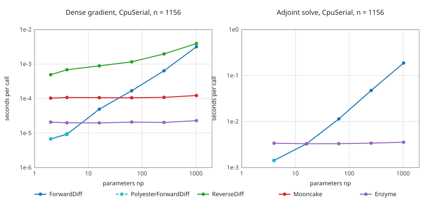

```@meta
CurrentModule = Bramble
CollapsedDocStrings = false
```

# Which AD backends earn their keep (gpena/Bramble.jl#369)

Bramble supports five AD backends through DifferentiationInterface: ForwardDiff,
PolyesterForwardDiff, ReverseDiff, Mooncake and Enzyme. This page reads the measurements of
[`benchmark/ad_backend_evaluation.jl`](https://github.com/gpena/Bramble.jl/blob/main/benchmark/ad_backend_evaluation.jl)
and recommends keep, keep for named uses, or drop for each. It recommends and does not
decide: the user decides, and the policy table that follows from the decision moves into
`docs/notes/internals/autodiff.md` and the `bramble-performance` skill in part 2.

Every figure below is read from `benchmark/results/ad_backend_evaluation.toml`, with
`status = "ok"` cells as the only timings. A cell is named as `workload, policy, np`. The
page quotes smoke figures (`benchmark/results/ad_backend_evaluation_smoke.toml`) only where
it says so.

## What was measured

The full run has 75 cells. Its meta records commit `383e77a95f269c26aaf905d2b5454d376b1f0d58`,
2026-10-31, an Apple M2 (aarch64, Darwin), Julia 1.13.3, 4 threads, a seeded non-uniform
2D mesh and a 3600 s timeout per cell. Each cell runs in a fresh child process that loads
one backend. The meta has no load key. The preflight 1-minute load average before the run
was 1.82 on 8 cores, as noted by the person who ran it, and the run had the machine's
thread pool to itself at 4 threads.

Three workloads, each checked against a central finite-difference reference (`relerr`):

- `dense_gradient`: the gradient of a scalar functional of `D₋ₓ`, `normₕ` and a linear
  form's assembly with respect to `np` entries of a nodal coefficient. `np` runs over 2, 4,
  16, 64, 256 and 1024 on a 34 x 34 mesh (n = 1156) under `CpuSerial`. At `np = 16` it also
  runs on a 41 x 41 mesh (n = 1681) under `CpuThreaded` and `CpuPolyester`.
- `adjoint_solve`: the gradient of ``J(\kappa) = \|u(\kappa) - d\|^2`` through
  `pde_solve(assemble(a(κ)), F)` with `np` free entries of κ, `CpuSerial`, n = 1156.
- `sparse_jacobian`: the `AutoSparse` Jacobian of a nonlinear-diffusion residual on a
  100 x 100 mesh (n = 10^4), `CpuSerial`. It has one size, so no scaling.

Each cell stores `first_call_s` (prepare plus first call, compilation included),
`per_call_s` (best of at least three prepared calls) and `allocs_bytes`. There is one run
per cell. Rows near 20 µs are short, so this page reads no difference under about 20 % on
them.

Cells whose status is `throws`, `unsupported` or `crash` are errors, not measurements:
they are never plotted or ranked as timings below.

## Correctness by policy

All `ok` cells agree with the reference to `relerr` at most 1.22e-7 (adjoint, np = 256),
under the 1e-6 limit. Dense `ok` cells are at most 1.1e-9.

### The adjoint np = 2 cells marked `wrong`

ForwardDiff, PolyesterForwardDiff and Enzyme each have an `adjoint_solve, CpuSerial, 2`
cell with status `wrong`. Their `relerr` values are 5.146166e-6, 5.146166e-6 and
5.146165e-6, equal to seven digits across three different mechanisms. The integrator
checked that the three gradients agree with each other to about 1e-15 (that comparison is
not stored in the results file). The error is therefore the finite-difference reference at
that size, not any backend. These cells count for no backend and the figure omits them.

### Dense gradient, CpuSerial, np from 2 to 1024

| Backend | ok cells of 6 | Other cells |
|:--|:--|:--|
| ForwardDiff | 6 | |
| PolyesterForwardDiff | 2 (np = 2, 4) | np = 16 to 1024 throw `cfunction: closures are not supported on this platform` |
| ReverseDiff | 6 | |
| Mooncake | 6 | |
| Enzyme | 6 | |

### Dense gradient across policies, np = 16, n = 1681

| Backend | CpuSerial | CpuThreaded | CpuPolyester |
|:--|:--|:--|:--|
| ForwardDiff | ok | ok | ok |
| PolyesterForwardDiff | throws (`cfunction`) | throws (`cfunction`) | throws (`cfunction`) |
| ReverseDiff | ok | ok | ok |
| Mooncake | ok | throws (`MooncakeRuleCompilationError`) | throws (`MooncakeRuleCompilationError`) |
| Enzyme | ok | throws (`AssertionError: mi2 !== nothing`) | throws (`IllegalTypeAnalysisException`) |

The `CpuSerial` column is the np = 16 cell of the 34 x 34 sweep above. The smoke run (2
threads, np = 16, the same 41 x 41 policy cells) gives the same ok and throws pattern in
every cell.

Four cells disagree with the table in #369, which was measured earlier on Julia 1.13.0:

- ReverseDiff under `CpuThreaded` and `CpuPolyester` is `ok` here, with `relerr` 5.66e-10
  equal to ForwardDiff's. #369 records `ConcurrencyViolationError`. A race on a shared tape
  need not fire on every run, so one `ok` cell does not show ReverseDiff is safe under a
  threaded policy.
- Enzyme under `CpuThreaded` throws here. #369 records `ok`.
- Enzyme under `CpuPolyester` throws here. #369 records a silently wrong gradient. The
  silent wrong answer did not reproduce in either run of this evaluation, and the cell
  raises, which is the outcome #369's acceptance criteria ask for. Whether the earlier
  value was fixed upstream or depended on the problem is not settled by these cells.
- PolyesterForwardDiff throws under all three policies here. #369 records `ok`.

The adjoint and sparse workloads ran under `CpuSerial` only. This page has no policy cell
for them and does not fill one in from #369.

### Adjoint solve, CpuSerial, np from 4 to 1024

| Backend | Result |
|:--|:--|
| ForwardDiff | ok at np = 4, 16, 64, 256, 1024. Needs `solver = :sparspak` and `F` promoted to the matrix's element type. |
| PolyesterForwardDiff | ok at np = 4. np = 16 to 1024 throw `cfunction`. |
| ReverseDiff | unsupported, all 6 cells: the imported `ChainRulesCore` rule takes `TrackedArray` arguments, and the assembled matrix is a `SparseMatrixCSC` of `TrackedReal`, so no imported method applies. |
| Mooncake | unsupported, all 6 cells: `@from_rrule` rejects the `SparseMatrixCSC` tangent. |
| Enzyme | ok at np = 4, 16, 64, 256, 1024, through `BrambleEnzymeExt`'s native `pde_solve` rule. |

### Sparse Jacobian, CpuSerial, n = 10^4

| Backend | Result |
|:--|:--|
| ForwardDiff | ok |
| PolyesterForwardDiff | ok |
| ReverseDiff | `crash`, which the file records as `timeout after 3600 s`: a timeout, not a measurement. In the smoke run (2 threads, n = 100) the same cell is ok at 22.8 ms, so the 3600 s is a scaling failure and the backend runs at small n. |
| Mooncake | ok |
| Enzyme | `crash`, exit code 134 (`__pthread_kill`). The smoke run (n = 100) crashes too, so the crash does not depend on size. |

## Cost against parameter count



Seconds per call against `np`, log-log, `ok` cells only, both panels `CpuSerial` with
n = 1156. PolyesterForwardDiff has points only at np = 2 and 4 on the dense panel, and at
np = 4 on the adjoint panel. ReverseDiff and Mooncake have no adjoint points because those
cells are unsupported. The np = 2 adjoint points are left out: the finite-difference
reference marks them `wrong`, not a backend.

### Dense gradient, per call, n = 1156

| np | ForwardDiff | PolyesterForwardDiff | ReverseDiff | Mooncake | Enzyme |
|--:|--:|--:|--:|--:|--:|
| 4 | 9.25 µs | 9.63 µs | 685 µs | 107 µs | 19.9 µs |
| 16 | 49.2 µs | throws | 887 µs | 107 µs | 19.7 µs |
| 64 | 169 µs | throws | 1.16 ms | 106 µs | 20.8 µs |
| 256 | 639 µs | throws | 1.97 ms | 109 µs | 20.3 µs |
| 1024 | 3.19 ms | throws | 3.94 ms | 123 µs | 22.9 µs |

### Adjoint solve, per call, n = 1156

| np | ForwardDiff | PolyesterForwardDiff | Enzyme |
|--:|--:|--:|--:|
| 4 | 1.43 ms | 1.40 ms | 3.38 ms |
| 16 | 3.28 ms | throws | 3.30 ms |
| 64 | 11.4 ms | throws | 3.31 ms |
| 256 | 47.5 ms | throws | 3.40 ms |
| 1024 | 188 ms | throws | 3.55 ms |

### Scaling and crossover

From np = 64 to np = 1024 (16 times the parameters), ForwardDiff's per-call cost grows
18.9 times on the dense gradient and 16.5 times on the adjoint solve: proportional to `np`.
Over the same range Enzyme's grows 1.10 times (dense) and 1.07 times (adjoint), Mooncake's
1.16 times (dense) and ReverseDiff's 3.38 times (dense). Allocation follows the same split.
At np = 1024 the ForwardDiff dense call allocates 45.1 MB against 90.8 kB for Enzyme, and
its adjoint call allocates 706 MB against 6.19 MB.

The crossover, as the pair of measured `np` that brackets it, with ForwardDiff as the
baseline:

| Workload | Against | Crossover |
|:--|:--|:--|
| dense gradient | Enzyme | between np = 4 (ForwardDiff 2.2 times faster) and np = 16 (Enzyme 2.5 times faster) |
| dense gradient | Mooncake | between np = 16 (ForwardDiff 2.2 times faster) and np = 64 (Mooncake 1.6 times faster) |
| dense gradient | ReverseDiff | none up to np = 1024: ForwardDiff is still 1.23 times faster there |
| adjoint solve | Enzyme | at about np = 16: ForwardDiff 1.006 times faster there, Enzyme 3.45 times faster at np = 64 |
| adjoint solve | Mooncake, ReverseDiff | none: unsupported |
| sparse Jacobian | all | one size only, so none. ForwardDiff is 2.34 ms, Mooncake 211 ms (90 times slower) |

Derived, by interpolating the ForwardDiff cost linearly between the bracketing cells, the
dense crossover with Enzyme is near np = 7 and the one with Mooncake near np = 39. These
are interpolations, not measurements, and the 20 µs Enzyme row is in the range this page
does not resolve.

Enzyme beats Mooncake at every np on the dense gradient, by 5.0 times at np = 2 and 5.4
times at np = 1024. ReverseDiff is the slowest reverse-mode backend at every np.

### Compile cost

`first_call_s`, `CpuSerial`, ok cells:

| Workload | ForwardDiff | PolyesterForwardDiff | ReverseDiff | Mooncake | Enzyme |
|:--|--:|--:|--:|--:|--:|
| dense gradient | 0.49 to 0.55 s | 0.75 to 0.76 s | 0.91 to 1.00 s | 22.0 to 22.2 s | 6.1 to 6.5 s |
| adjoint solve | 3.3 to 3.8 s | 3.78 s (np = 4) | unsupported | unsupported | 99 to 101 s |
| sparse Jacobian | 1.26 s | 1.31 s | timeout | 56.5 s | crash |

The adjoint figure includes compiling the mesh, form and solve code every backend shares,
which is why ForwardDiff reads 3.3 s there against 0.5 s on the dense gradient.

Derived, the extra first-call time over ForwardDiff divided by the per-call saving at the
same np is the number of gradient calls that repay a reverse-mode backend's compile cost.
For Enzyme on the adjoint solve it is about 520 calls at np = 1024, 2170 at np = 256 and
11 900 at np = 64. On the dense gradient it is about 1770 calls at np = 1024 and 9030 at
np = 256. For Mooncake on the dense gradient it is about 7050 calls at np = 1024.

### Policy cells and the sweep

The policy cells use a different mesh (n = 1681) from the sweep (n = 1156), so their
`per_call_s` is not comparable with the serial table. Within them ForwardDiff measures
318 µs under `CpuThreaded`, 67.5 µs under `CpuPolyester`, and ReverseDiff 1.14 ms and
1.06 ms.

## Enzyme and ForwardDiff

### Cost scaling with parameter count

ForwardDiff is cheaper below an np between 4 and 16 on the dense gradient and below about
16 on the adjoint solve (the table above). Above that its cost is proportional to `np`, and Enzyme's
is flat: at np = 1024 Enzyme is 139 times faster on the dense gradient (22.9 µs against
3.19 ms) and 53 times faster on the adjoint solve (3.55 ms against 188 ms). A forward-mode
backend repeats the solve per direction, up to chunking, so this is the expected shape;
the cells are the evidence for where it bites in Bramble.

### Compile cost

ForwardDiff costs 0.5 s (dense) and 3.3 to 3.8 s (adjoint) on the first call. Enzyme costs
6.1 to 6.5 s (dense) and 99 to 101 s (adjoint). Enzyme repays that only with enough
parameters and enough calls: the derived break-even is about 520 adjoint calls at
np = 1024 and about 12 000 at np = 64. A single gradient evaluation at small `np`, such as
a test or a one-off sensitivity, favours ForwardDiff on both counts.

### Policy safety

ForwardDiff is ok on the dense gradient under `CpuSerial`, `CpuThreaded` and `CpuPolyester`
(np = 16), and ok on the sparse Jacobian. Enzyme is ok under `CpuSerial` only: it throws
under both threaded policies (np = 16, n = 1681) and crashes the process on the sparse
Jacobian (exit 134, in both the full run at n = 10^4 and the smoke run at n = 100). The
failure under `CpuPolyester` raises, so it cannot pass silently in this run.

### What each cannot do

ForwardDiff: its cost is proportional to `np` divided by the chunk size, and its memory
too (the allocation figures above). Every buffer an operation allocates inside Bramble must
widen to `Dual`. The adjoint workload shows the price: its default `\` overflows the stack
on a `Dual` sparse matrix, so the ForwardDiff route needs `solver = :sparspak` and `F`
promoted to the matrix's element type (the workload's header in
`benchmark/ad_backend_evaluation.jl` records both). That is the bug class of subplans S2
and S3 of the v4.2.0 evaluation plan.

Enzyme: it differentiates `Float64` code, so no buffer widens and the adjoint cell needs
neither workaround. It pays for that in four ways the cells show. It compiles for 6 s to
100 s per workload. It throws under both threaded policies. It crashes on the sparse
Jacobian. It needs `Enzyme.set_runtime_activity` and `function_annotation = Enzyme.Const`
on these workloads (`make_backend` in the benchmark, and the comments of
`test/space/autodiff_heavy.jl`). `BrambleEnzymeExt` also rejects batched (vector-mode)
reverse differentiation of `pde_solve` with an `ArgumentError`. Some Bramble code is shaped
so Enzyme can type it: see the comments at `test/form/common.jl` lines 131 and 159 and
`test/form/simplifier.jl` lines 76 and 725.

Mooncake also differentiates `Float64` code. It shares the compile and threaded-policy
failures (22 s on the dense gradient, 56.5 s on the sparse Jacobian; throws under both
threaded policies) and adds one limit: it has no `pde_solve` adjoint, because `@from_rrule`
rejects the `SparseMatrixCSC` tangent (all six adjoint cells).

### The ARM cfunction error

Every cell with `cfunction: closures are not supported on this platform` is a
PolyesterForwardDiff cell: dense at np of 16 or more under every policy, and adjoint at np
of 16 or more. No Enzyme or Mooncake cell shows it, and each child process loads one
backend, so Enzyme is not loaded in the PolyesterForwardDiff cells. The error appears at np of 16 or more and not at np = 2 or 4, which is consistent with
the work needing more than one chunk (an inference, not tested). #257 attributes
the same message on the macOS ARM runners to an Enzyme reverse-mode VJP path, from a stack
that also carries `AutoPolyesterForwardDiff`. These cells put it on the PolyesterForwardDiff
side. They do not cover `EnzymeVJP` through SciML, which this evaluation did not run.

## Unique coverage and maintenance

Each backend is counted by what only it needs. Test files are those that run the backend,
not those that mention its name (ForwardDiff alone is named in over 40 test files, most as
a reference).

| Backend | Extension of its own | Test files that run it | Extra packages in the environment |
|:--|:--|:--|:--|
| ForwardDiff | none (`BrambleSciMLExt` mentions it) | `test/form/autodiff.jl`, `test/form/forwarddiff_smoke.jl`, `test/space/autodiff.jl`, `test/space/autodiff_backends.jl`, `test/space/autodiff_policies.jl`, `test/ext/sparse_ad_ext.jl`, `test/ext/ad_backend_verification.jl`, and references in the other files | none: it is in `test/Project.toml` |
| PolyesterForwardDiff | none (`BramblePolyesterExt` is the Polyester policy, not this backend) | `test/space/autodiff_backends.jl`, `test/space/autodiff_heavy.jl`, `test/space/autodiff_policies.jl` | `PolyesterForwardDiff` |
| ReverseDiff | `BrambleReverseDiffExt`, 37 lines: a `mul!` disambiguation between `KroneckerLinearOperator` and `TrackedArray` | `test/form/autodiff.jl`, `test/space/autodiff_backends.jl`, `test/space/autodiff_heavy.jl`, `test/space/autodiff_policies.jl`, `test/ext/ad_backend_verification.jl`, plus the extension's check in `test/quality/explicit_imports.jl` | `ReverseDiff` (weak dependency) |
| Mooncake | none (`BrambleChainRulesExt` also serves Zygote and any ChainRules consumer) | `test/space/autodiff_backends.jl`, `test/space/autodiff_heavy.jl`, `test/space/autodiff_policies.jl`, `test/ext/chainrules_enzyme_ext.jl` (a pinned `@test_throws` for the missing sparse tangent) | `Mooncake` |
| Enzyme | `BrambleEnzymeExt`, 104 lines: the native `pde_solve` reverse rule | `test/space/autodiff_backends.jl`, `test/space/autodiff_heavy.jl`, `test/space/autodiff_policies.jl`, `test/ext/chainrules_enzyme_ext.jl` (35 mentions), `test/examples/inverse_diffusion.jl`, plus the extension's check in `test/quality/explicit_imports.jl` | `Enzyme` (weak dependency) |

CI time for these backends is zero today. `WITH_AD_TESTS` (`test/TestUtils.jl`) is off in
every group until v4.2.0, so no test above runs in a gate. No CI time was measured for this
page. The compile cost in the section above is the measured proxy: a run of the AD group
pays Mooncake's 22 s (dense) and 56.5 s (sparse) and Enzyme's 6 s to 100 s once per
workload, per process, against ForwardDiff's 0.5 s to 3.8 s.

Unique coverage, by use in Bramble:

- ForwardDiff is the only backend that completes all three workloads. With ReverseDiff it
  is also ok on every dense policy cell of this run. The sparse Newton Jacobian in `BrambleSparseADExt` uses `AutoForwardDiff`
  in its tests (`test/ext/sparse_ad_ext.jl`).
- Enzyme is the only backend with a working `pde_solve` adjoint cell, and the only one
  flat in `np` on it.
- PolyesterForwardDiff covers nothing ForwardDiff does not: where it runs (np of 4 or
  less, and the sparse Jacobian), its per-call cost is within 5 % of ForwardDiff's (9.63
  against 9.25 µs at np = 4; 2.334 against 2.336 ms on the sparse Jacobian).
- ReverseDiff covers dense reverse mode, which Enzyme and Mooncake cover faster at every
  np (dense gradient, CpuSerial, np from 2 to 1024). It has no adjoint cell and times out
  on the sparse Jacobian at n = 10^4.
- Mooncake covers dense reverse mode and the sparse Jacobian. Enzyme is 5 times faster on
  the first and ForwardDiff 90 times faster on the second.

## Device AD

The device AD issue is gpena/Bramble.jl#381 in milestone #38 (v4.7.0). Its scope is "for
each backend #369 keeps", and it names these paths: ForwardDiff `Dual` element types
through device storage and kernels, the sparse Newton Jacobian (`BrambleSparseADExt`) with
device residual evaluation, the `pde_solve` adjoint rule (`BrambleChainRulesExt` and
`BrambleEnzymeExt`) with a device sparse matrix, and `Bramble.adjoint_sensitivities` with a
device-resident state for the VJP backends #257 verifies. This evaluation ran no Metal
cell, so none of these paths has a measurement on a device here. The cost of dropping a
backend is what #381 would lose.

- ForwardDiff: dropping it removes the `Dual` path and the sparse Newton Jacobian, the two
  items of #381 that no other backend carries. It is also the backend that passes the most
  CPU cells, so the natural reference for a device leg.
- PolyesterForwardDiff: #381 does not name it. Polyester is CPU threading, so dropping the
  backend costs nothing on the device path.
- ReverseDiff: #381 does not name it. Dropping it costs nothing on the device path.
- Mooncake: #381 reaches it only as a VJP candidate for `adjoint_sensitivities` through
  #257. It has no `pde_solve` adjoint on the CPU (all six adjoint cells unsupported), so
  there is no CPU rule for #381 to carry. Dropping it removes one of the two VJP
  candidates.
- Enzyme: dropping it removes `BrambleEnzymeExt` from the device scope, and with Mooncake
  dropped too, the VJP backend for `adjoint_sensitivities`. The `ChainRulesCore` rrule
  stays for Zygote and other ChainRules consumers, but this evaluation found no
  reverse-mode backend that can import it for the solve path (ReverseDiff and Mooncake are
  unsupported on every adjoint cell). Without Enzyme the device adjoint has no measured
  route.

Whether `Dual` or Enzyme runs on Metal storage at all is not measured here and is #381's
first question.

## Recommendation

One row per backend. The policies column lists where the backend has an `ok` cell in the
full run: dense policy cells at np = 16 and n = 1681, the other workloads under
`CpuSerial` only. The user decides, and part 2 is planned from that decision.

| Backend | Recommendation | Policies | Reason |
|:--|:--|:--|:--|
| ForwardDiff | keep | CpuSerial, CpuThreaded, CpuPolyester (dense, np = 16); CpuSerial (adjoint, sparse) | Only backend ok on all three workloads, and ok on every dense policy cell (as is ReverseDiff). Cheapest below an np between 4 and 16 (dense) and about 16 (adjoint) and 90 times faster than Mooncake on the sparse Jacobian (2.34 ms against 211 ms). Compile 0.5 to 3.8 s. Limits: cost and allocation proportional to np (18.9 times from np = 64 to 1024), and the adjoint needs the `:sparspak` route to widen to `Dual`. |
| PolyesterForwardDiff | drop | CpuSerial only, and only np of 4 or less (dense, adjoint) plus the sparse Jacobian | Within 5 % of ForwardDiff wherever it runs (9.63 against 9.25 µs at np = 4; 2.334 against 2.336 ms sparse). Throws `cfunction` in every dense and adjoint cell at np of 16 or more, under every policy, on this aarch64 host. Needs a package and three test files for no unique coverage. An x86 run is not measured here. |
| ReverseDiff | drop | CpuSerial; CpuThreaded and CpuPolyester at np = 16 (disagrees with #369) | 18 to 74 times slower than ForwardDiff at np of 16 or less and still 1.23 times slower at np = 1024, with no crossover in the sweep. Slowest reverse-mode backend at every np, 3.94 ms against Enzyme's 22.9 µs at np = 1024. Unsupported on all six adjoint cells and a 3600 s timeout on the sparse Jacobian at n = 10^4 (22.8 ms at n = 100 in the smoke run). Costs `BrambleReverseDiffExt` and five test files. |
| Mooncake | drop | CpuSerial (dense, sparse) | Flat in np (106 to 123 µs) but 5.0 to 5.4 times slower than Enzyme on the dense gradient at every np, and slower than ForwardDiff at np of 16 or less (the crossover lies between np = 16 and 64). 22 s compile (dense), 56.5 s (sparse), 90 times slower than ForwardDiff on the sparse Jacobian. All six adjoint cells unsupported (no sparse tangent), and both threaded policy cells throw. Revisit only if a sparse tangent for `SparseMatrixCSC` lands upstream (the issue names `MooncakeSparse.jl`). |
| Enzyme | keep for reverse mode with many parameters: the `pde_solve` adjoint and dense gradients at np of 16 or more, `CpuSerial` only | CpuSerial (dense, adjoint) | Only backend with a working adjoint cell, flat in np (3.30 ms at np = 16, 3.55 ms at np = 1024 against ForwardDiff's 188 ms). 139 times faster than ForwardDiff on the dense gradient at np = 1024. Throws under both threaded policies and crashes on the sparse Jacobian (exit 134, also at n = 100). Compile 6 s (dense) and 99 to 101 s (adjoint), repaid after about 520 adjoint calls at np = 1024 (derived). Costs `BrambleEnzymeExt`. |
