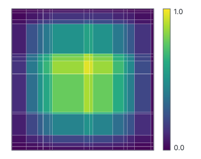

```@meta
CurrentModule = Bramble
```

# Getting started

A Poisson problem, end to end, in fifteen lines. Six steps take a continuous problem to a
solved grid function, and every tutorial afterwards is one of them in detail.

```@raw html
<figure style="margin:1.5em 0;text-align:center">
<svg viewBox="0 0 760 150" width="100%" style="max-width:760px;height:auto;font-family:system-ui,-apple-system,'Segoe UI',sans-serif"
     xmlns="http://www.w3.org/2000/svg" role="img"
     aria-label="The six steps of a Bramble solve: domain, mesh, grid space, form, assemble, solve, each labelled with the function that performs it.">
  <defs>
    <marker id="gsArrow" viewBox="0 0 10 10" refX="8" refY="5" markerWidth="6" markerHeight="6" orient="auto-start-reverse">
      <path d="M 0 1.5 L 8 5 L 0 8.5 z" fill="currentColor"/>
    </marker>
  </defs>

  <g font-size="12" text-anchor="middle">
    <rect x="10"  y="40" width="104" height="44" rx="6" fill="none" stroke="#3b82f6" stroke-width="1.5"/>
    <text x="62"  y="60" fill="currentColor" font-weight="bold">geometry</text>
    <text x="62"  y="76" fill="#3b82f6">domain</text>

    <rect x="140" y="40" width="104" height="44" rx="6" fill="none" stroke="#3b82f6" stroke-width="1.5"/>
    <text x="192" y="60" fill="currentColor" font-weight="bold">points</text>
    <text x="192" y="76" fill="#3b82f6">mesh</text>

    <rect x="270" y="40" width="104" height="44" rx="6" fill="none" stroke="#3b82f6" stroke-width="1.5"/>
    <text x="322" y="60" fill="currentColor" font-weight="bold">unknowns</text>
    <text x="322" y="76" fill="#3b82f6">gridspace</text>

    <rect x="400" y="40" width="104" height="44" rx="6" fill="none" stroke="#8b5cf6" stroke-width="1.5"/>
    <text x="452" y="60" fill="currentColor" font-weight="bold">equation</text>
    <text x="452" y="76" fill="#8b5cf6">form</text>

    <rect x="530" y="40" width="104" height="44" rx="6" fill="none" stroke="#8b5cf6" stroke-width="1.5"/>
    <text x="582" y="60" fill="currentColor" font-weight="bold">matrix</text>
    <text x="582" y="76" fill="#8b5cf6">assemble</text>

    <rect x="660" y="40" width="90" height="44" rx="6" fill="none" stroke="#10b981" stroke-width="1.5"/>
    <text x="705" y="60" fill="currentColor" font-weight="bold">solution</text>
    <text x="705" y="76" fill="#10b981">A \ F</text>
  </g>

  <g stroke="currentColor" stroke-width="1.2" marker-end="url(#gsArrow)">
    <path d="M 118 62 L 134 62"/>
    <path d="M 248 62 L 264 62"/>
    <path d="M 378 62 L 394 62"/>
    <path d="M 508 62 L 524 62"/>
    <path d="M 638 62 L 654 62"/>
  </g>

  <text x="380" y="118" font-size="11" fill="currentColor" opacity="0.75" text-anchor="middle">
    the same six steps in 1D, 2D and 3D, linear or nonlinear, steady or transient
  </text>
</svg>
</figure>
```

## The problem

```math
-\Delta u = g \text{ in } \Omega = (0,1)^2, \qquad u = u_{\text{exact}} \text{ on } \partial\Omega
```

with the manufactured solution $u_{\text{exact}}(x, y) = \sin(\pi x)\sin(\pi y)$, so
$g = 2\pi^2 u_{\text{exact}}$. The known solution makes the error
computable.

## The code

```@example gs
using Bramble

uexact(x) = sinpi(x[1]) * sinpi(x[2])
g(x) = 2π^2 * uexact(x)

Ω = domain(interval(0.0, 1.0) × interval(0.0, 1.0))   # geometry plus boundary labels
Ωₕ = mesh(Ω, (33, 33), (true, true))                  # 33 × 33 points, uniformly spaced
Wₕ = gridspace(Ωₕ)                                    # one unknown per point

gₕ = element(Wₕ)
Rₕ!(gₕ, g)                                            # the source, sampled at the points

a = form(Wₕ, Wₕ, (u, v) -> inner₊(∇ₕ(u), ∇ₕ(v)))    # the discrete Laplacian
l = form(Wₕ, v -> innerₕ(gₕ, v))                      # the load
bcs = dirichlet_constraints(Ω, :boundary => uexact)

A, F = assemble(a, l; dirichlet = bcs)

uₕ = element(Wₕ)
uₕ .= A \ F

normₕ(uₕ .- Rₕ(Wₕ, uexact))
```

Four parts in ten thousand.



The same problem on a random 17 × 17 grid, coloured by the solution. The grid in the code is
uniform, which keeps the example short, but a uniform grid can flatter a scheme: the
[linear Poisson example](examples/poisson_linear.md) checks convergence on a random
non-uniform grid for that reason. Halving the spacing should
cut the error by four, since the scheme is second order:

```@example gs
function poisson_error(n)
    Ωₕ = mesh(Ω, (n, n), (true, true))
    Wₕ = gridspace(Ωₕ)
    gₕ = element(Wₕ)
    Rₕ!(gₕ, g)
    A, F = assemble(
        form(Wₕ, Wₕ, (u, v) -> inner₊(∇ₕ(u), ∇ₕ(v))),
        form(Wₕ, v -> innerₕ(gₕ, v));
        dirichlet = dirichlet_constraints(Ω, :boundary => uexact))
    uₕ = element(Wₕ)
    uₕ .= A \ F
    return normₕ(uₕ .- Rₕ(Wₕ, uexact))
end

e₁, e₂ = poisson_error(33), poisson_error(65)

e₁, e₂, log2(e₁ / e₂)
```

## Forms and assembly

`a` and `l` are expressions in the trial and test functions. `form` stores the expression
and `assemble` walks the mesh, so the same `a` can be refilled every step of a time loop,
handed to a nonlinear solver, or differentiated.

## Coding with Claude

The repository includes a [Claude Code](https://code.claude.com) plugin with the API by task,
the rules that keep Bramble code correct (exported versus `public` names, seeding random
meshes, literal integer coefficients in forms) and worked examples whose results are checked.
Install it from Claude Code with `/plugin marketplace add gpena/Bramble.jl`, then
`/plugin install bramble@bramble`.

## Reading order

Read the tutorials in the order of the sidebar, top to bottom. The [worked
examples](examples/poisson_linear.md) then run the whole chain on real problems.

- [Geometry tutorial](tutorials/geometry.md): Describe where a problem lives: a set, its named boundary pieces and the domain that bundles both.
- [Mesh tutorial](tutorials/mesh.md): Turn a domain into a mesh, make its points non-uniform, and read the spacings and cell measures.
- [Grid spaces and discrete functions](tutorials/space.md): Put a function on a mesh, measure it, and stack copies into a composite space.
- [Difference, jump and average operators](tutorials/operators.md): Apply differences, jumps and averages, see what each does at the grid edge, and get the matrix.
- [Linear and bilinear forms](tutorials/form.md): Write, assemble and solve a linear or bilinear form, with Dirichlet conditions, for a Poisson problem.
- [Coupled systems](tutorials/coupled_systems.md): Write a form over several unknowns, constrain one block, and read values across different meshes.
- [Automatic differentiation](tutorials/autodiff.md): Differentiate a discrete quantity with respect to a parameter, and choose between the two backends.
