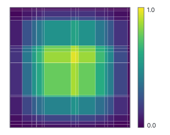
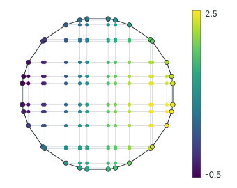
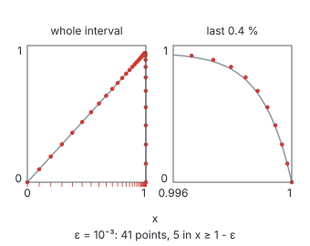
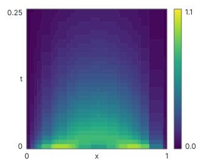
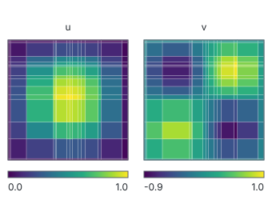
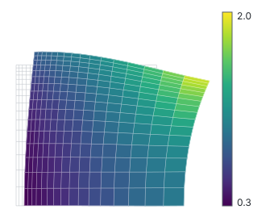
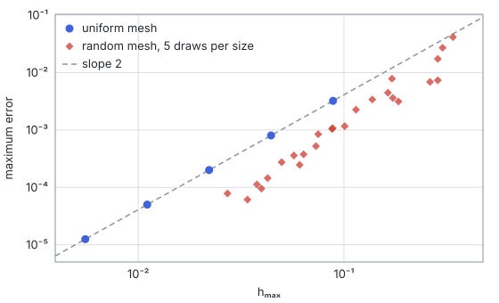

```@meta
CurrentModule = Bramble
```

# Bramble.jl

```@raw html
<!-- Real Markdown links below instead of raw HTML <a> tags: Documenter rewrites a `.md`-target
     link to the right URL for whichever build mode is active. These <div>s only wrap the
     styling; the interspersed Markdown still goes through normal link resolution. -->
<section class="bramble-hero">
<p class="bramble-hero-lede">A Julia library for solving partial differential equations with finite differences on non-uniform grids, written in notation close to the mathematics.</p>
<div class="bramble-hero-actions">
```

[Getting started](getting_started.md) [Examples](examples/poisson_linear.md)

```@raw html
</div>
<p class="bramble-badges">
<a href="https://julialang.org"></a>
<a href="https://github.com/gpena/Bramble.jl/actions?query=workflow%3ACI"></a>
<a href="https://codecov.io/gh/gpena/Bramble.jl"></a>
<a href="https://github.com/gpena/Bramble.jl/blob/main/LICENSE"></a>
<a href="https://doi.org/10.5281/zenodo.14230821"></a>
</p>
</section>
<div class="bramble-home-cards">
<div class="bramble-card">
```

**[Non-uniform meshes](tutorials/mesh.md)**

Put the grid points where the solution changes: a mesh's points can take any non-uniform spacing.

```@raw html
</div>
<div class="bramble-card">
```

**[Problems as forms](tutorials/form.md)**

Write a problem as bilinear and linear forms built from discrete operators. `assemble` turns them into a sparse matrix and a right-hand side.

```@raw html
</div>
<div class="bramble-card">
```

**[Time-dependent problems](examples/heat_equation.md)**

Discretise in space with Bramble and pass the resulting system of ODEs to a time stepper from the SciML ecosystem.

```@raw html
</div>
</div>
```

## Gallery

```@raw html
<div class="bramble-gallery">
<div class="bramble-card">
```

[](examples/poisson_linear.md)

**[Poisson on a random grid](examples/poisson_linear.md)**

Interior points placed at random, grid lines drawn over the solution.

```@raw html
</div>
<div class="bramble-card">
```

[](examples/poisson_circle.md)

**[A disk](examples/poisson_circle.md)**

The grid gains lines until each one meets the circle at a node. The ringed nodes are the boundary.

```@raw html
</div>
<div class="bramble-card">
```

[](examples/boundary_layer_graded.md)

**[A boundary layer](examples/boundary_layer_graded.md)**

A graded grid puts points in a layer a thousandth wide.

```@raw html
</div>
<div class="bramble-card">
```

[](examples/heat_equation.md)

**[The heat equation](examples/heat_equation.md)**

Two decaying modes on a random grid, with ``x`` across and ``t`` up.

```@raw html
</div>
<div class="bramble-card">
```

[](examples/coupled_reaction_diffusion.md)

**[Two coupled species](examples/coupled_reaction_diffusion.md)**

A reaction-diffusion system in ``u`` and ``v`` on one random grid.

```@raw html
</div>
<div class="bramble-card">
```

[](examples/elasticity_traction_2d.md)

**[Elasticity](examples/elasticity_traction_2d.md)**

A graded grid moved by the computed displacement, drawn at ``x + 0.2\,u``.

```@raw html
</div>
</div>
```

## Installation

```julia
using Pkg
Pkg.add(url = "https://github.com/gpena/Bramble.jl")
```

## A first solve

The Poisson problem ``-\Delta u = g`` on the unit square, with zero boundary values and exact solution ``u(x, y) = \sin(\pi x)\sin(\pi y)``:

```julia
using Bramble

uexact(x) = sinpi(x[1]) * sinpi(x[2])
g(x) = 2π^2 * uexact(x)

Ω = domain(interval(0.0, 1.0) × interval(0.0, 1.0))   # the unit square
Ωₕ = mesh(Ω, (33, 33), (true, true))                  # 33 × 33 points, uniformly spaced
Wₕ = gridspace(Ωₕ)                                    # one unknown per point
gₕ = element(Wₕ)
Rₕ!(gₕ, g)                                            # the source, sampled at the points

a = form(Wₕ, Wₕ, (u, v) -> inner₊(∇ₕ(u), ∇ₕ(v)))    # the discrete Laplacian
l = form(Wₕ, v -> innerₕ(gₕ, v))                      # the load
A, F = assemble(a, l; dirichlet = dirichlet_constraints(Ω, :boundary => uexact))

uₕ = element(Wₕ)
uₕ .= A \ F
maximum(abs, uₕ .- Rₕ(Wₕ, uexact))                     # about 8e-4
```

Passing `false` instead of `true` for an axis places its interior points at random, which gives a non-uniform grid. [Getting started](getting_started.md) explains each step.

The maximum error against `hₘₐₓ`, on uniform meshes and on random ones, for five sizes from 17 to 257 points per axis. Five random draws per size; the dashed line has slope 2.



## References

The schemes follow these papers:

* J. A. Ferreira and R. D. Grigorieff, [On the supraconvergence of elliptic finite difference schemes](https://doi.org/10.1016/S0168-9274(98)00048-8), Applied Numerical Mathematics 28 (1998), pp. 275-292

* S. Barbeiro, J. A. Ferreira and R. D. Grigorieff, [Supraconvergence of a finite difference scheme for solutions in ``H^s(0,L)``](https://doi.org/10.1093/imanum/dri018), IMA Journal of Numerical Analysis 25.4 (2005), pp. 797–811

* J. A. Ferreira and R. D. Grigorieff, [Supraconvergence and Supercloseness of a Scheme for Elliptic Equations on Nonuniform Grids](https://doi.org/10.1080/01630560600796485), Numerical Functional Analysis and Optimization 27.5-6 (2006), pp. 539–564
