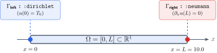
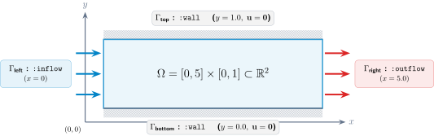
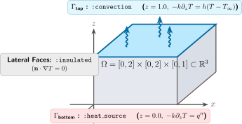

```@meta
CurrentModule = Bramble
```

# [Geometry tutorial](@id tutorial_geometry)

**What you will learn.** How to describe where a problem lives: a set, the names of its boundary pieces, and the domain that bundles both.

**What you need first.** Only a working install, see the [home page](../index.md#Installation).

**Where next.** The [mesh tutorial](@ref tutorial_mesh) turns a domain into a grid of points.

---

## A first domain: a rod

Take a rod of length 10, held at a fixed temperature at its left end and insulated at the right end. The geometry is an interval, and the two ends need names so that a condition can later be attached to each:



```@example geometry
using Bramble
import Bramble: point, center, projection, topo_dim

rod = domain(interval(0.0, 10.0), :dirichlet => :left, :neumann => :right)

dim(rod), center(rod), collect(labels(rod))
```

[`interval`](@ref) builds the closed interval ``[0, 10]``. Each `label => side` pair is a **marker**: a name for a piece of the boundary. [`domain`](@ref) bundles the set with its markers, and a [`Domain`](@ref) is what [`mesh`](@ref) takes. `dim` is the dimension of the space the rod lives in, and `center` its midpoint.

Without markers, `domain(interval(0.0, 10.0))` labels the whole external boundary `:boundary`.

!!! tip "Try this"
    Replace the interval by `interval(0.0, 10.0) × interval(0.0, 1.0)` and keep the two markers. `dim` becomes 2, and `:left` and `:right` still name the two short sides of a 2D strip, but in 3D they are the `y` faces.

---

## Sets in more than one dimension

The tensor product operator `×` (`\times<tab>`) builds hyper-rectangles from intervals:

```@example geometry
I = interval(0.0, 1.0)
Ω_2d = I × I
Ω_3d = interval(-1.0, 1.0) × interval(0.0, 2.0) × interval(0.0, 0.5)
```

A set answers geometric questions. `∈` accepts a number in 1D, and in any dimension a tuple or vector of length `dim`:

```@example geometry
X = interval(0.0, 2.0) × interval(-1.0, 1.0)

dim(X), extrema(X), extrema(X, 1), center(X)
```

```@example geometry
0.5 ∈ I, 1.5 ∈ I, (0.5, 0.5) ∈ Ω_2d, (1.2, 0.3) ∈ Ω_2d
```

`extrema(X, 1)` is the range along the first axis, and `projection(X, 1)` is that axis as an interval.

!!! tip "Try this"
    Evaluate `(1.2, 0.3) ∈ X` and `(1.2, 1.3) ∈ X`. The second point leaves the box through the top.

---

## Naming boundary pieces

A marker is a `:label => identifier` pair. The identifier is one boundary symbol, a tuple of them, or a predicate. Boundary symbols are coordinate-aligned (`:xmin`, `:xmax`, `:ymin`, `:ymax`, and so on, with aliases such as `:left` and `:top`), and the [geometry reference](@ref geometry_reference) lists them all.

A channel with inflow on the left, outflow on the right and no-slip walls on top and bottom:



```@example geometry
geom = interval(0.0, 5.0) × interval(0.0, 1.0)

channel = domain(
    geom,
    :inflow => :left,
    :outflow => :right,
    :wall => (:top, :bottom)
)

dim(channel), center(channel), collect(labels(channel))
```

The tuple `(:top, :bottom)` gives one name to two faces. Markers are only names at this stage: no boundary condition is attached until a problem is posed on the mesh built from the domain, see the [form tutorial](form.md).

!!! tip "Try this"
    Change `:wall => (:top, :bottom)` to `:top_wall => :top, :bottom_wall => :bottom`, and print `collect(labels(channel))` again. Two names let a later problem treat the two walls differently.

A predicate marks any subset, not only a face. Its argument is the point `p`; a marker set built over a time interval takes `(p, t)` predicates:

```@example geometry
using LinearAlgebra

m_cond = markers(
    geom,
    :inflow => :left,
    :hot_spot => (p -> p[1] > 2.5 && p[2] ≈ 0.0)
)

m_time = markers(
    geom,
    interval(0.0, 10.0),
    :moving_source => ((p, t) -> norm(p .- [t, 0.5]) < 0.2)
)

collect(labels(m_cond)), m_time(1.5)      # the second is the marker set frozen at t = 1.5
```

[`labels`](@ref) returns one tuple of every label, symbol markers first, then tuple markers, then predicate markers, then the three labels of each polygon or level-set marker, built without allocating. The helpers `label_symbols`, `label_tuples` and `label_conditions` behind it are internal.

---

## A domain in three dimensions

The same two ideas, a set and named faces, carry over unchanged. A heat sink, heated below, cooled above and insulated on its four sides:



```@example geometry
sink = domain(
    interval(0.0, 2.0) × interval(0.0, 2.0) × interval(0.0, 1.0),
    :heat_source => :zmin,
    :convection => :zmax,
    :insulated => (:xmin, :xmax, :ymin, :ymax)
)

center(sink), collect(labels(sink))
```

A `Domain` forwards the geometric queries of the previous sections to its set:

```@example geometry
Ω = domain(
    I × I,
    :dirichlet => (:left, :right),
    :neumann => (:top, :bottom)
)

dim(Ω), center(Ω), (0.5, 0.5) ∈ Ω, Bramble.is_collapsed(Ω)
```

[`Bramble.set`](@ref) (private, hence the prefix) returns the underlying set.
